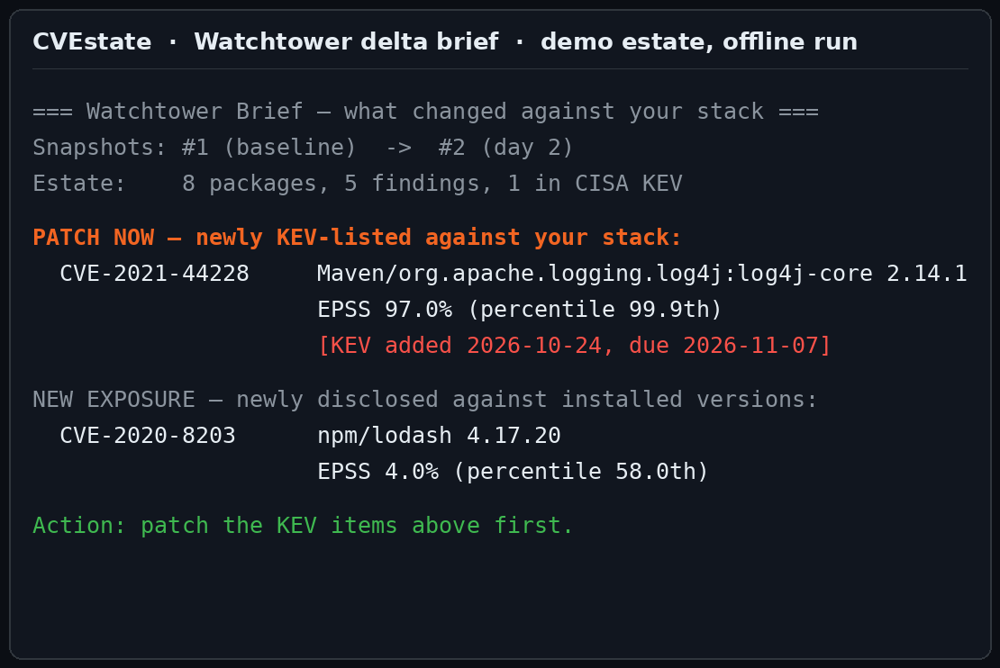
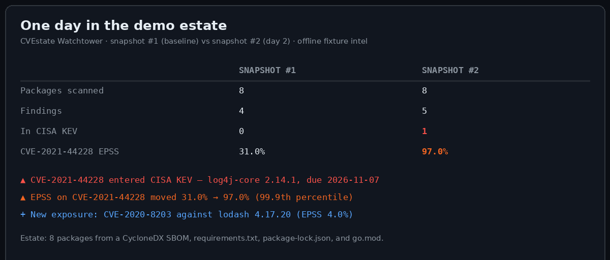

<div align="center">

# CVEstate

**Your CVE intel remembers your estate. CVEstate watches what changed against it.**

[](LICENSE)
[](pyproject.toml)
[](#tests)
[](#the-server)
[](https://github.com/enabled404/cvestate/releases/tag/v1.0.0)

</div>

Vulnerability intel tools answer lookups. Ask about a CVE and you get
its CVSS, its EPSS, its KEV status, its timeline, a risk score. Ask
again tomorrow and you get the same work done twice, because the tool
kept nothing. Your estate sat unchanged in the middle: the same
packages, the same versions, quietly waiting for the day one of their
CVEs turns into a headline.

CVEstate keeps the estate. You hand it your SBOMs and lockfiles once,
and from then on every scan snapshots your exposure and diffs it
against the last one. The output leads with the only movement that
matters: a CVE on your stack entering CISA KEV, an EPSS score spiking
overnight, a fresh disclosure against a version you actually run.
Underneath the watch sits a full MCP security-intelligence server: 28
lookup and triage tools across NVD, EPSS, CISA KEV, OSV, Shodan,
VirusTotal, GreyNoise, and 20+ more sources, plus the 4 Watchtower
tools that give it a memory.

**Contents:** [See the watch fire](#see-the-watch-fire) ·
[Before and after](#before-and-after-one-day-in-the-demo-estate) ·
[Watchtower](#watchtower--the-estate-watch) ·
[The server](#the-server--28-intelligence-tools) ·
[Install](#install) · [Quickstart](#quickstart) ·
[Repository layout](#repository-layout) · [Tests](#tests) ·
[Contributing](#contributing) · [License](#license) ·
[Credits](#credits)

---

## See the watch fire

The launch demo runs fully offline against a small estate assembled
from four real files: a CycloneDX SBOM carrying log4j-core 2.14.1, a
requirements.txt, an npm lockfile, a go.mod. Eight packages in total.
Day 1, CVE-2021-44228 sits in the exposure list with an EPSS of 31%
and no KEV listing. Day 2, CISA adds it to KEV with a remediation due
date, and its EPSS jumps to 97%. Here is the brief the second scan
produces:



That block is the whole product in one screen. The CVE was already in
the estate on day 1, and a lookup tool would have shown the same
record both days. The watch caught the change, ranked it above
everything else that moved, and attached the date CISA expects a fix
by. The demo ships in [`examples/watchtower/`](examples/watchtower/)
and reproduces with six commands, no API keys, no network.

---

## Before and after: one day in the demo estate

| | Snapshot #1 (baseline) | Snapshot #2 (day 2) |
|---|---|---|
| Packages scanned | 8 | 8 |
| Findings | 4 | 5 |
| In CISA KEV | 0 | 1 |
| CVE-2021-44228 EPSS | 31.0% | 97.0% |
| New exposure | | CVE-2020-8203 (lodash 4.17.20) |



Every number in that table comes from the demo run itself, captured
in the build evidence. The diff engine separates the movement into
classes (NEW_KEV, EPSS_SPIKE, NEW_EXPOSURE, RESOLVED, package changes)
so a brief reads as a work list, ranked by urgency.

---

## Watchtower — the estate watch

Watchtower is the system CVEstate 1.0.0 adds. It lives in
`src/cve_mcp/watchtower/` and plugs into the base server as four MCP
tools plus a CLI.

### Estate store

A persistent SQLite inventory at `~/.cve-mcp/estate.db` (override with
`WATCHTOWER_DB_PATH`), opened with the same WAL pragmas as the base
cache. Ingestion accepts the formats your pipeline already produces:

| Format | Source |
|---|---|
| CycloneDX JSON | SBOM generators (Syft, cdxgen, build plugins) |
| SPDX JSON | SBOM generators |
| `requirements.txt` | Python |
| `package-lock.json` (v1–v3) | npm |
| `go.mod` | Go |

Package URLs are mapped to OSV ecosystems automatically, and
re-adding a package preserves its `first_seen` date. The estate
remembers when every package entered your stack.

### Snapshot engine

Each scan walks the estate and records exposure using the base
project's own intel clients: OSV for package vulnerabilities, the
pre-warmed CISA KEV catalog for known-exploited status and due dates,
one batched EPSS call for exploitation probability. A snapshot is a
dated, labelled, queryable record of your exposure at that moment.

### Diff engine

Consecutive snapshots are compared by a pure function that classifies
every change:

| Event | Fires when |
|---|---|
| `NEW_KEV` | A CVE in your estate is KEV-listed in the new snapshot and was unlisted in the old one |
| `EPSS_SPIKE` | A finding's EPSS delta meets the threshold (default 10 points, configurable) |
| `NEW_EXPOSURE` | A finding appears that the old snapshot lacked |
| `RESOLVED` | A finding disappears (patched, upgraded, or removed) |
| `PACKAGE_ADDED` / `PACKAGE_REMOVED` | Estate membership changed between snapshots |

### The surface

**MCP tools** (registered alongside the base 28):

| Tool | What it does |
|---|---|
| `estate_add` | Parse an SBOM or lockfile pasted as text and ingest it into the estate |
| `estate_scan` | Snapshot the estate now and summarize exposure |
| `watch_diff` | Diff the two latest snapshots |
| `watch_brief` | Emit the prioritized patch brief: KEV first, EPSS spikes second, new exposure third |

**CLI** (same operations, scriptable, cron-friendly):

```bash
cve-watch add estate.cdx.json
cve-watch scan --label monday
cve-watch diff
cve-watch brief
```

The CLI takes `--db` for the estate path and `--fixture` for offline
runs against a fixture intel file, which is how the demo and the test
suite drive it with zero network.

---

## The server — 28 intelligence tools

The foundation layer is a production MCP server with a one-call triage
orchestrator and 27 lookup tools across 24 data sources.

**Start with `triage_cve`.** One call fans out to NVD, EPSS, CISA KEV,
and public PoC discovery in parallel, then scores the result with a
composite model (CVSS × 0.20 + EPSS × 0.35 + KEV × 0.30 + PoC × 0.15).
A KEV listing hard-overrides the label to CRITICAL: confirmed
in-the-wild exploitation outranks arithmetic. At `depth=deep` it adds
an SSVC v2 decision, and when NVD throttles, it falls back to the
VulnCheck NVD++ index transparently.

| Category | Tools |
|---|---|
| Core vulnerability intel (8) | `lookup_cve` · `search_cves` · `get_epss_score` · `check_kev` · `parse_cvss` · `get_cve_summary` · `check_package_vulns` · `health_check` |
| Exploit and ATT&CK (4) | `check_exploit_availability` · `get_vendor_advisory` · `get_attack_mapping` · `get_cve_timeline` |
| Risk and reporting (4) | `check_poc_exists` · `calculate_risk_score` · `generate_vuln_report` · `compare_cves` |
| Network intel (4) | `check_ip_reputation` · `get_domain_intel` · `passive_dns_lookup` · `shodan_host_lookup` |
| Threat intel (4) | `lookup_file_hash` · `check_url_safety` · `lookup_malware_family` · `check_ransomware_intel` |
| DevSecOps (3) | `scan_dependencies` · `scan_container_packages` · `scan_repo_secrets` |
| Orchestrator (1) | `triage_cve` |

The server also exposes MCP resources (`kev://catalog`,
`epss://scores/{cve_id}`, a SHA-256 tool-manifest hash) and prompts
(`patch_decision`, `compare_and_prioritize`, `dependency_triage`). It
serves over stdio by default, or streamable HTTP with
`MCP_TRANSPORT=http`. Operational hardening carries over from the base
project: structured audit logging on every tool call, SSRF and
private-IP guards on outbound requests, secrets held as `SecretStr`,
and a standing rule that the server never issues sampling requests.

### A note on fresh installs

CVEstate 1.0.0 pins the MCP dependency to the 1.x line
(`mcp[cli]>=1.7.0,<2.0.0`). The base project's unbounded requirement
resolved to mcp 2.x, which removed the FastMCP module the server
imports, and a fresh install crashed before it could answer a single
question. The pin is the same fix the upstream project's dependabot
branch proposed. Fresh installs start, and the project's CI runs green
against it.

---

## Install

Requires Python 3.10 or newer.

```bash
git clone https://github.com/enabled404/cvestate.git
cd cvestate
python -m venv .venv && source .venv/bin/activate
pip install -e .
```

Copy `.env.example` to `.env` and add the API keys you hold (NVD,
Shodan, VirusTotal, and friends). Several sources need no key at all,
and the entire Watchtower demo runs offline with none.

Point any MCP client at the server:

```json
{
  "mcpServers": {
    "cvestate": {
      "command": "cve-mcp",
      "args": []
    }
  }
}
```

A ready-made `.mcp.json` ships at the repository root. Docker works
too: `docker build -t cvestate .` then run with `--env-file .env`.

## Quickstart

**Watch your estate (offline demo, two minutes):**

```bash
export WATCHTOWER_DB_PATH=/tmp/demo-estate.db
cve-watch add examples/watchtower/estate.cdx.json
cve-watch add examples/watchtower/requirements.txt
cve-watch add examples/watchtower/package-lock.json
cve-watch add examples/watchtower/go.mod
cve-watch scan --label baseline --fixture examples/watchtower/intel_v1.json
cve-watch scan --label day2     --fixture examples/watchtower/intel_v2.json
cve-watch brief
```

The brief leads with CVE-2021-44228 entering KEV against your
log4j-core 2.14.1, EPSS 31% → 97%, due 2026-11-07.

**Run the watch live:** drop `--fixture` and the scan uses the real
OSV, KEV, and EPSS clients. Add your real SBOMs, scan on a schedule,
and read the brief each morning.

**Triage a single CVE:** connect the MCP server to your client and
call `triage_cve` with any CVE ID, or ask for `estate_add`,
`estate_scan`, and `watch_brief` in conversation.

---

## Repository layout

```
src/cve_mcp/
  server.py          the FastMCP server: 28 intel tools, resources, prompts
  api/               22 client and intel modules (NVD, EPSS, KEV, OSV, Shodan, VT, ...)
  cache/             aiosqlite response cache (WAL)
  utils/             risk scorer, SSVC, fan-out, validators, source trust
  watchtower/        the estate watch added in CVEstate 1.0.0
    parsers.py       CycloneDX / SPDX / requirements / package-lock / go.mod
    store.py         persistent estate + snapshot store (SQLite)
    engine.py        snapshot builder + pure diff engine
    brief.py         delta brief and snapshot summaries
    tools.py         estate_add, estate_scan, watch_diff, watch_brief
    cli.py           the cve-watch CLI
    fixtures.py      offline fixture intel provider (demo + tests)
tests/               78 tests, all offline
examples/watchtower/ the offline demo: estate files + day-1/day-2 intel
```

Runtime identity, for anyone scripting against the base project: the
Python package stays `cve_mcp`, the MCP server name stays `cve-mcp`,
and the console scripts stay `cve-mcp` and `cve-watch`. CVEstate is the
release name over the top of them.

## Tests

```bash
pip install -e ".[test]"
python -m pytest -q
```

78 passing: the 30 base tests intact, plus 48 Watchtower tests
covering parsers (14), the estate store (8), the snapshot and diff
engines (15), the brief (5), and MCP tool registration and flow (6).
Every test runs offline; intel is injected as fixtures.

## Contributing

See [CONTRIBUTING.md](CONTRIBUTING.md). Issues and pull requests are
welcome at the [CVEstate repository](https://github.com/enabled404/cvestate).

## License

Apache License, Version 2.0. See [LICENSE](LICENSE) and
[NOTICE](NOTICE).

## Credits

CVEstate builds on the [CVE MCP Server](https://github.com/mukul975/cve-mcp-server)
by Mahipal Jangra (Apache-2.0) and extends it with the Watchtower
estate-watch system. The 28 intelligence tools, the triage
orchestrator, and the source clients are the foundation layer's work;
Watchtower, the estate store, the snapshot and diff engines, the delta
brief, the `cve-watch` CLI, and the fresh-install repair are the new
work in this release. Full attribution lives in [NOTICE](NOTICE).
